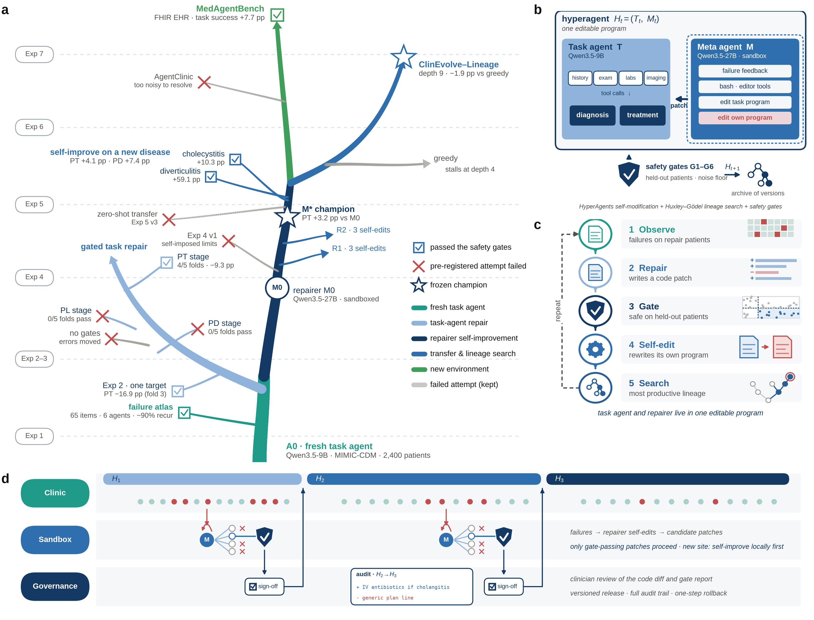

# ClinEvolve

ClinEvolve repairs a tool-using clinical agent by editing its program, and only keeps edits that pass safety gates. The
agent and its repairer form one program: the task agent (`task_agent.py`) and the repairer (`meta_agent.py`). The
repairer can edit both, including itself.

<p align="center">
  
</p>

**Figure 1.** **a**, The seven experiments as a lineage of program versions, from the fresh task agent A0 through gated
task repair, repairer self-improvement, lineage search and transfer to MedAgentBench. Ticks mark versions that passed
the safety gates; crosses mark pre-registered attempts that failed and are kept in the record. **b**, The program:
the task agent T (Qwen3.5-9B) gathers the history, examination, laboratory and imaging findings and gives a diagnosis
and treatment plan; the repairer M (Qwen3.5-27B) reads the failure feedback in a sandbox and uses bash and an editor to
patch the task program or its own program. A new version is accepted only if it passes safety gates G1–G6 on held-out
patients. **c**, The cycle: observe failures, write a code patch, gate it, let the repairer edit its own program and
search for the most productive lineage. **d**, Deployment: failures in the clinic go to the sandbox, only gate-passing
patches proceed, and every release is signed off by clinicians with a full audit trail.

```bash
git clone https://github.com/Merwin520/ClinEvolve.git
cd ClinEvolve
```

This repository contains the method:

| Component | Module | Paper (Methods) |
|---|---|---|
| Task agent A0 and clinical tools (history, physical examination, laboratory, imaging, microbiology) | `task_agent.py`, `agent/` | Task agent and clinical endpoints |
| Clinical failure endpoints PD, PL, PT, FD, IT, computed from the trajectory and the patient record | `clinevolve/endpoints/`, `clinevolve/evaluate.py` | Task agent and clinical endpoints |
| Repairer M0: one sandboxed session (bash + editor) per candidate version | `meta_agent.py`, `clinevolve/generate.py`, `clinevolve/generation_worker.py` | ClinEvolve |
| Repair feedback package | `clinevolve/feedback.py` | ClinEvolve |
| Safety gates G1–G6 | `clinevolve/gates.py` | Safety gates |
| Single-target repair with CI@k selection | `clinevolve/repair.py` | Experiments 4, 5 and 7 (repair branches) |
| Sequential repair PD → PL → PT with archive | `clinevolve/sequential.py` | Experiment 3 |
| Repairer self-improvement (two-round tournament, expected safe gain) | `clinevolve/self_improve.py`, `clinevolve/meta_check.py` | Experiments 4 and 5 |
| ClinEvolve–Lineage search (clade metaproductivity) and the greedy and uniform policies | `clinevolve/lineage.py` | Experiment 6 |
| Tree-search single-target repair and the earlier gate specification | `clinevolve/tree_repair.py`, `clinevolve/search/`, `clinevolve/gates_exp2.py` | Experiment 2 |

Experiment drivers, patient splits, locked-test runs, baselines, statistics and plotting code are not part of this
repository.

## Requirements

- Linux with [bubblewrap](https://github.com/containers/bubblewrap) (`bwrap`), used to sandbox every repairer session.
- Python 3.12.
- GPUs for vLLM serving. The paper used four A100s: one for the repairer model and three for the task model.
- MIMIC-CDM, available from PhysioNet to credentialed users under the MIMIC data-use agreement. It is not distributed here.

```bash
python3.12 -m venv .venv && source .venv/bin/activate
pip install -r requirements.txt
```

## Setup

1. **Data.** Place the MIMIC-CDM CSV files in `data/mimic-cdm/`, or point `paths.mimic_cdm_dir` (or the environment
   variable `MIMIC_CDM_DATA_DIR`) to their directory.

2. **Case manifest.** Create `data/cases.csv` with one row per case:

   | column | meaning |
   |---|---|
   | `case_id` | MIMIC-IV `hadm_id` |
   | `subject_id`, `patient_id` | patient identifier |
   | `disease` | appendicitis, cholecystitis, diverticulitis or pancreatitis |
   | `outer_fold` | partition id; use `1` for a single split |
   | `role` | `repair` (feedback for the repairer), `validation` (gates and selection) or `locked_test` (held-out evaluation) |

   Split by patient, so each patient is in exactly one role per partition. The repairer never sees `validation` or
   `locked_test` cases, and no procedure in this repository evaluates `locked_test` cases. Only
   `python -m clinevolve evaluate --role locked_test`, run explicitly, does.

3. **Models.** Serve the task model and the repairer model:

   ```bash
   scripts/serve_models.sh meta 8500 0      # Qwen3.5-27B, repairer
   scripts/serve_models.sh task 8801 1      # Qwen3.5-9B, task agent (repeat on more GPUs/ports as available)
   ```

   Then list the server URLs in `configs/clinevolve.yaml` (`models.task.servers`, `models.meta.servers`).

## Usage

All commands take `--config configs/clinevolve.yaml` (the default) and `--partition N`. They write results under
`paths.work_dir` and can be resumed.

```bash
# run a program (default: A0) on one cohort; prints the per-case endpoint table (parquet)
python -m clinevolve evaluate --role validation --id A0

# single-target repair of A0: 10 candidates, gated on validation, selected version for k = 5 and k = 10
python -m clinevolve repair --target PT

# sequential repair PD -> PL -> PT with an archive of capacity 2
python -m clinevolve sequential

# self-improvement of the repairer; writes runs/self_improve/p1/champion/meta_agent.py
python -m clinevolve self-improve
python -m clinevolve repair --target PT --repairer runs/self_improve/p1/champion/meta_agent.py --tag Mstar

# lineage search with a frozen repairer (policies: lineage, greedy, uniform)
python -m clinevolve lineage --policy lineage --repairer runs/self_improve/p1/champion/meta_agent.py

# check that an edited repairer program is still valid (no LLM call)
python -m clinevolve check-repairer path/to/meta_agent.py
```

The selected task-agent program is a directory containing a modified `task_agent.py`. Its path is printed at the end
of each command and stored in the state file. To evaluate it on held-out cases:

```bash
python -m clinevolve evaluate --program <selected program dir> --role locked_test --id final
```

### Tree-search repair (paper Experiment 2)

```bash
python -m clinevolve.tree_repair --outer-fold 1 --target-id treatment_guideline_failure \
  --run-manifest configs/tree_search_run_manifest.json --fold-manifest data/cases.csv \
  --a0-repo . --meta-model openai/qwen3.5-27b --output-root runs/tree_search
python -m clinevolve.gates_exp2 --parent-eval ... --candidate-eval ... --target-id ... \
  --gate-spec configs/exp2_gate_spec.json --parent-id A0 --candidate-id ... --output ...
```

## Method settings

`configs/clinevolve.yaml` holds the settings used in the paper:

- **Gates:** target gain ≥ 1 pp; retention ≤ +2 pp; other workflow endpoints ≤ +3 pp; final diagnosis ≤ +1 pp; each
  tool-safety endpoint ≤ +0.6 pp; tool calls ≤ 1.25×; tokens ≤ 1.5×; new regressions ≤ 5 pp above the A0
  replicate floor.
- **Task model:** temperature 0, at most 4,096 output tokens per turn, at most 40 tool calls, thinking off. These
  values are fixed inside `task_agent.py`, and candidates that change them are rejected.
- **Repairer model:** temperature 0.7, at most 2,048 output tokens per turn.

`self-improve` has two selection rules. The default selects the best self-edited program (the target-side rule).
`--incumbent-competes` lets M0 and the parent compete and win ties. Add `--round1-score best_safe_gain` to score round
one by the best gate-passing gain.

## Reproducibility notes

- vLLM batched inference with Qwen3.5 is not bitwise deterministic, and the repairer samples at temperature 0.7. Two
  runs therefore produce different candidate programs. A0 is evaluated twice on the validation cohort (`A0` and
  `A0rep`), and the replicate sets the new-regression noise floor (gate G6).
- Effects that depend on whether a run happens to produce a gate-passing candidate, such as differences between two
  repairers or between search policies, vary from run to run. Estimate them over repeated runs.
- Every candidate is stored with its code difference (`patches/`), the repairer transcript (`gen/*_meta_chat.md`), its
  per-case evaluation and its gate decision.

## License and attribution

This code builds on HyperAgents (Zhang et al., 2026, [arXiv:2603.19461](https://arxiv.org/abs/2603.19461); Meta Platforms, Inc.), which is
licensed under CC BY-NC-SA 4.0. As a derivative work, this repository is released under the same license; see
`LICENSE.md` and `NOTICE.md`. The lineage policy follows the clade-metaproductivity idea of the Huxley–Gödel Machine.
The clinical endpoints are adapted from the MIMIC-CDM evaluation of Hager et al. (2024).
